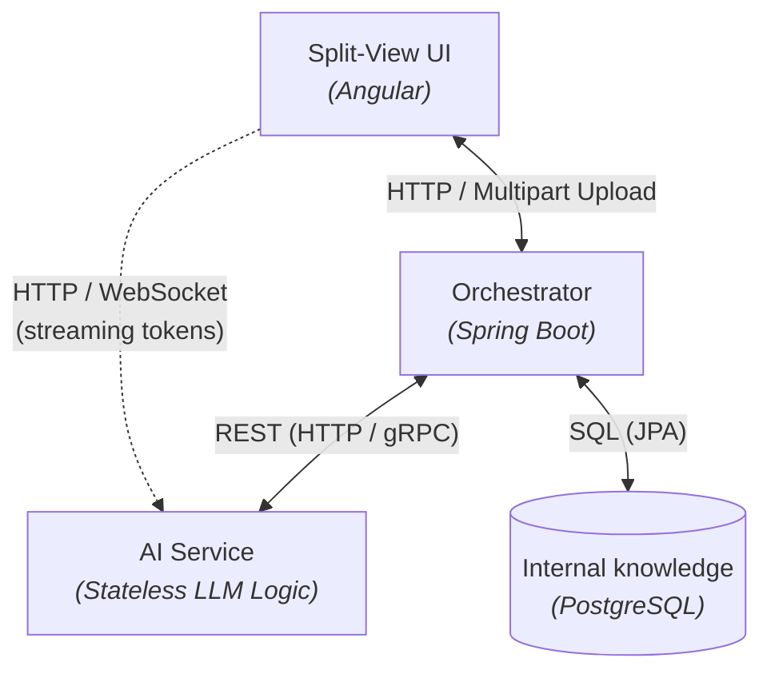

# KIDA

## About
KIDA (Knowledge-Integrated Document Assistant) is an intelligent document processing prototype that pairs uploaded files with internal and external ground truth. It automates file-based workflows by offering both dynamic, single-click task execution and interactive, document-grounded Q&A.

## System Architecture

