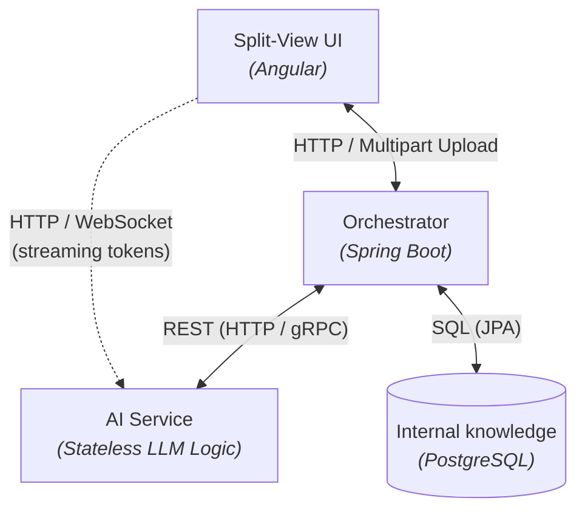

# KIDA (Knowledge-Integrated Document Assistant)

KIDA is a prototype platform designed to speed up document processing by combining incoming files with internal company data.

Instead of an open-ended chatbot, KIDA uses a structured, button-driven workflow: users upload a document, and the system extracts identifiers, fetches verified internal context, and runs targeted tasks with human-in-the-loop review.

## Key Features

* **Document-Driven Workflow:** Files serve as input, context, and query keys—not generic chat prompts.

* **Internal Ground Truth Enrichment:** Automatically links document contents to records in a database.

* **Split-View Interface:** View the source document side-by-side with extracted form fields and task results.

* **Stateless AI Processing:** Deterministic document extraction and reasoning without storing session data in the model layer.

* **Audit Logging:** Full tracking of uploads, state transitions, and AI task executions.

## Architecture & Tech Stack

